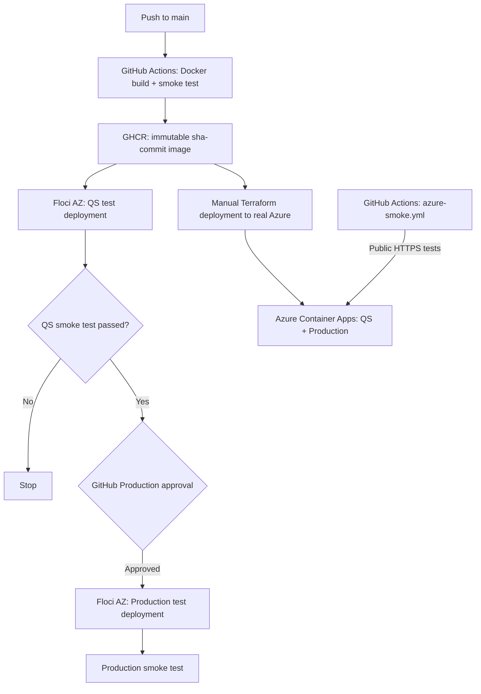

# Azure Containerized Web App

[](https://github.com/emacs45/azure-containerized-webapp/actions/workflows/container.yml)
[](https://github.com/emacs45/azure-containerized-webapp/actions/workflows/azure-smoke.yml)

A containerized **Nginx web application** deployed to **Azure Container Apps** with Terraform and tested with **GitHub Actions**. The project also uses [Floci AZ](https://github.com/floci-io/floci-az) to emulate Azure Container Apps locally and exercise a CI/CD release-approval workflow.

The same immutable image from **GitHub Container Registry (GHCR)** runs in both **QS** and **Production**, with the environment-specific content supplied through container environment variables.

## Project status

| Capability | Status |
| --- | --- |
| Docker build, health check and GHCR publishing | Implemented |
| Terraform deployment to local Floci AZ | Tested successfully |
| GitHub Actions QS tests and manual Production approval | Implemented with temporary Floci runners |
| Terraform deployment to real Azure Container Apps | **Tested successfully in an Azure lab** |
| Public HTTPS endpoints for Azure QS and Production | **Both tested successfully** |
| GitHub-hosted HTTPS smoke tests against real Azure | **Tested successfully** |
| Automated GitHub Actions deployment to real Azure | **Not yet implemented** |

The real Azure deployment created one Container Apps Environment and two Container Apps. Both returned the correct environment marker and version `1.0.0` over HTTPS, using the **same SHA-tagged GHCR image**.

## Architecture



**Important distinctions:**

- **Floci CI:** QS and Production use separate, temporary GitHub-hosted runners and independent emulator instances. The Production job is gated by a protected GitHub Environment. This tests the approval process; it does not update a persistent production deployment.
- **Real Azure:** Terraform successfully deployed the same image to persistent Azure Container Apps in a training lab. The deployment was performed **manually**, not from GitHub Actions.
- **Azure smoke workflow:** GitHub Actions connects to the already-running public Azure endpoints over HTTPS. It does not authenticate to Azure or provision resources.

## Tech stack

- **Nginx, Docker:** Static web app rendered from `app/index.html.template` using `DEPLOY_ENV` and `APP_VERSION`
- **GitHub Container Registry:** Public images tagged `sha-<commit>` and `latest`
- **Terraform (AzureRM 4.x):** Infrastructure as Code for Container Apps and their environment
- **Azure Container Apps:** Real cloud deployment with public HTTPS ingress
- **Floci AZ:** Azure-compatible local emulator with actual Docker-backed Container Apps
- **GitHub Actions:** Container build, integration tests, and a manual release approval gate

## Repository structure

```text
.
├── .github/workflows/
│   ├── container.yml           # Build, publish, Floci QS, approval, Floci Production
│   └── azure-smoke.yml         # On-demand HTTPS tests against real Azure
├── app/index.html.template     # Environment-specific Nginx page
├── scripts/smoke-test.sh       # Floci ingress tests: qs / production / all
├── terraform-local/            # Terraform configuration for Floci AZ
├── Dockerfile
├── .dockerignore
└── README.md
```

The **real Azure Terraform configuration** was validated from a separate local `terraform/` directory. **That directory has not yet been committed to this repository.** To reproduce Azure provisioning from a fresh clone, it must first be added (without any Terraform state or local credentials).

## Environments

| Setting | QS | Production |
| --- | --- | --- |
| Container App | `ca-webapp-qs` | `ca-webapp-production` |
| `DEPLOY_ENV` | `qs` | `production` |
| `APP_VERSION` | `1.0.0` | `1.0.0` |
| Target port | `80` | `80` |
| Image | GHCR SHA tag | **Same GHCR SHA tag** |
| Floci ingress | Local HTTP via `localhost:4577` | Local HTTP via `localhost:4577` |
| Real Azure ingress | Public HTTPS | Public HTTPS |

The real Azure environment uses scale-to-zero settings (0–1 replicas); the local Floci configuration uses one replica per app.

## Run locally with Floci AZ

**Prerequisites:** Docker Engine, Terraform with AzureRM 4.x, Bash, Python 3, `curl`, OpenSSL and CA certificate tools.

### 1. Start Floci

```bash
docker run -d \
  --name floci-az \
  -p 127.0.0.1:4577:4577 \
  -v /var/run/docker.sock:/var/run/docker.sock \
  -e FLOCI_AZ_TLS_ENABLED=true \
  -e FLOCI_AZ_SERVICES_CONTAINER_APPS_MOCKED=false \
  floci/floci-az:latest

curl -fsS http://localhost:4577/_floci/health
```

`MOCKED=false` enables real Docker-backed replicas rather than simulated resource state only.

> **Security:** The Docker socket grants powerful access to the host. Run Floci only in a trusted development environment or an isolated CI runner.

### 2. Trust the local TLS certificate (Linux/WSL)

Terraform's AzureRM provider discovers the Floci cloud endpoints over HTTPS.

```bash
curl -fsS http://localhost:4577/_floci/tls-cert -o /tmp/floci-az.crt
sudo cp /tmp/floci-az.crt /usr/local/share/ca-certificates/floci-az.crt
sudo update-ca-certificates

curl -fsS https://localhost:4577/metadata/endpoints
```

If Floci regenerates its certificate, refresh the trusted certificate before using Terraform again.

### 3. Deploy and test

Choose a [published GHCR image tag](https://github.com/emacs45/azure-containerized-webapp/pkgs/container/azure-containerized-webapp). This tag is a known working example:

```bash
IMAGE_TAG="sha-fcd36828a7a50786c920478817716dc8cac6b483"

terraform -chdir=terraform-local init
terraform -chdir=terraform-local validate
terraform -chdir=terraform-local plan \
  -var="image_tag=$IMAGE_TAG" \
  -var="production_image_tag=$IMAGE_TAG"
terraform -chdir=terraform-local apply \
  -var="image_tag=$IMAGE_TAG" \
  -var="production_image_tag=$IMAGE_TAG"

bash scripts/smoke-test.sh qs
bash scripts/smoke-test.sh production
```

The smoke tests obtain FQDNs from Terraform outputs and send requests to `localhost:4577` with the appropriate HTTP `Host` header. They fail if an app is unavailable or returns the wrong environment marker.

```text
Testing qs (...)...
PASS: qs
Testing production (...)...
PASS: production
All requested smoke tests passed.
```

### 4. Clean up

```bash
terraform -chdir=terraform-local destroy \
  -var="image_tag=$IMAGE_TAG" \
  -var="production_image_tag=$IMAGE_TAG"
docker rm -f floci-az
```

**Terraform-state caution:** Do not switch `deploy_environments` from both environments to just QS or Production against an existing shared state without reviewing the plan; Terraform would propose destroying the omitted app. The CI jobs use fresh, separate states to avoid this problem.

## GitHub Actions workflows

### 1. [Build and Publish Container](.github/workflows/container.yml)

Triggered by eligible pushes to `main` or manually:

1. Build the Docker image and run a container smoke test.
2. Publish `sha-<commit>` and `latest` to GHCR.
3. Start Floci AZ on a GitHub-hosted runner, deploy **QS** with Terraform, and run an ingress smoke test.
4. Wait for approval from the protected **production** GitHub Environment.
5. On a separate runner, deploy and test **Production**, using the **same immutable SHA-tagged image**.

This workflow validates a CI/CD release gate in an emulated environment. It does **not** deploy to the real Azure lab.

### 2. [Azure Container Apps Smoke Tests](.github/workflows/azure-smoke.yml)

A manually triggered (`workflow_dispatch`) GitHub Actions workflow that checks the **real Azure QS and Production HTTPS endpoints** for the expected environment markers and version.

- **Requires no Azure credentials:** It only sends HTTPS requests to public endpoints.
- **Does not deploy or update Azure:** The apps must already exist.
- **Lab-specific URLs:** The workflow currently uses endpoints from the training lab. Update them after recreating the environment; the tests will fail when the lab expires or its apps are deleted.

The first manually triggered Azure smoke-test workflow completed successfully.

## Real Azure deployment

The real Azure lab deployment was created using Terraform in a local `terraform/` configuration against an **existing lab resource group**. It provisioned:

- One Azure Container Apps Environment (`cae-containerized-webapp`)
- One QS Container App (`ca-webapp-qs`)
- One Production Container App (`ca-webapp-production`)

Both applications successfully served their environment-specific HTML over public HTTPS with the **same GHCR image** (`sha-fcd36828a7a50786c920478817716dc8cac6b483`).

Log Analytics was intentionally omitted in this lab configuration. The real Azure Terraform code and state are distinct from `terraform-local/`; **the real Azure Terraform directory still needs to be added to the repository** for full reproducibility.

A complete Azure deployment automation would also require a dedicated GitHub Actions deployment identity (preferably OIDC), appropriate Azure RBAC roles, and persistent remote Terraform state. These are **not** configured in this project yet.

## Limitations and next steps

- **Floci is an emulator:** It does not reproduce all Azure platform behavior, networking, security policies, or scaling semantics.
- **Training lab resources are temporary:** Live Azure URLs and manual smoke tests depend on the lab remaining active.
- **No automated Azure provisioning from GitHub Actions yet:** Azure deployments are performed with locally authenticated Terraform; GitHub Actions currently validates the live Azure endpoints only.
- **Recommended next steps:** Commit the real Azure Terraform files without state or credentials; add OIDC-based deployment credentials and remote state if a suitable Azure subscription becomes available.

For safety and cost control, review Terraform plans and destroy lab resources when no longer needed.
