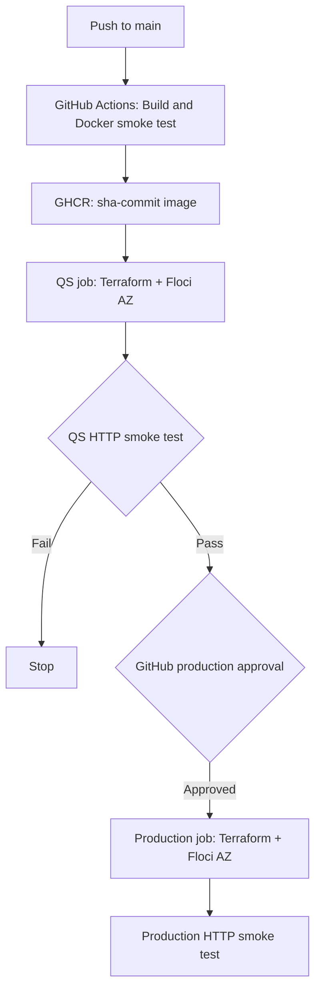

# Azure Containerized Web App

[](https://github.com/emacs45/azure-containerized-webapp/actions/workflows/container.yml)

A small **Infrastructure as Code and CI/CD demonstration** that builds an Nginx web application, publishes an immutable Docker image to GitHub Container Registry (GHCR), and deploys it to **QS** and **Production** using Terraform and [Floci AZ](https://github.com/floci-io/floci-az), a local Azure emulator.

The project exercises an Azure Container Apps-style deployment and release approval flow **without requiring an Azure subscription**. Floci AZ runs the application containers through a local Docker engine; it is not a production Azure deployment.

## Architecture



**Important:** The QS and Production CI jobs each start a **separate, temporary Floci AZ instance** on their own GitHub-hosted runner. An approval gates the Production test deployment, but the workflow does **not** promote an existing, persistent Azure environment. Both jobs deploy the same immutable GHCR image tag (`sha-${GITHUB_SHA}`).

## Tech stack

- **Nginx + Docker:** Lightweight web application with environment-specific content and a container health check
- **GHCR:** Public container image tagged by Git commit SHA (also published as `latest` for convenience)
- **Terraform / AzureRM:** Resource group, Container Apps Environment, and container applications
- **Floci AZ:** Local emulation of Azure Resource Manager and Azure Container Apps, with real Docker-backed containers
- **GitHub Actions:** Build, image publishing, integration tests, and a manual Production approval gate

## Repository structure

```text
.
├── .github/workflows/container.yml  # Build, QS test, Production approval and test
├── app/index.html.template          # Nginx environment-variable template
├── scripts/smoke-test.sh            # HTTP integration tests (qs/production/all)
├── terraform-local/                 # Working Floci AZ Terraform deployment
├── terraform/                       # Real Azure Terraform configuration (lab access dependent)
├── Dockerfile
└── .dockerignore
```

## Deployment environments

| Setting | QS | Production |
| --- | --- | --- |
| Container App name | `ca-webapp-qs` | `ca-webapp-production` |
| `DEPLOY_ENV` | `qs` | `production` |
| `APP_VERSION` | `1.0.0` | `1.0.0` |
| Container port | `80` | `80` |
| Replicas (local) | `1` | `1` |
| Image | GHCR `sha-<commit>` | Same GHCR `sha-<commit>` |

Both apps use HTTP ingress through the local emulator on `localhost:4577`; routing uses the `Host` header returned by Terraform. **Local Floci ingress is not a public Azure HTTPS endpoint.**

## Run locally with Floci AZ

### Prerequisites

- Docker Engine, Terraform 1.x with the AzureRM 4.x provider, Bash, Python 3, `curl`, and OpenSSL/CA certificate tools
- A working local Docker daemon and permission to use its socket
- Access to the public image at `ghcr.io/emacs45/azure-containerized-webapp`

> **Security:** Mounting `/var/run/docker.sock` gives the Floci container powerful access to the host Docker engine. Run it only in a trusted local development environment or an isolated CI runner.

### 1. Start the emulator

```bash
docker run -d \
  --name floci-az \
  -p 127.0.0.1:4577:4577 \
  -v /var/run/docker.sock:/var/run/docker.sock \
  -e FLOCI_AZ_TLS_ENABLED=true \
  -e FLOCI_AZ_SERVICES_CONTAINER_APPS_MOCKED=false \
  floci/floci-az:latest

curl -fsS http://localhost:4577/_floci/health
```

The `MOCKED=false` setting is essential: Floci runs actual Docker containers for the Container App replicas.

### 2. Trust the emulator's local TLS certificate (Linux/WSL)

The AzureRM provider uses HTTPS to discover the emulated Azure endpoints. Floci generates a local self-signed certificate.

```bash
curl -fsS http://localhost:4577/_floci/tls-cert -o /tmp/floci-az.crt
sudo cp /tmp/floci-az.crt /usr/local/share/ca-certificates/floci-az.crt
sudo update-ca-certificates
curl -fsS https://localhost:4577/metadata/endpoints
```

Alternatively, configure `SSL_CERT_FILE` to point to a CA bundle containing both the system certificates and the Floci certificate. If Floci regenerates its certificate, update the trusted certificate before the next Terraform run.

### 3. Deploy the applications

Choose a **published image tag** from the [GHCR package](https://github.com/emacs45/azure-containerized-webapp/pkgs/container/azure-containerized-webapp). A README-only commit does not necessarily create a new image because the workflow is path-filtered.

```bash
# Example of a known published image; replace with a newer published SHA as needed.
IMAGE_TAG="sha-fcd36828a7a50786c920478817716dc8cac6b483"

terraform -chdir=terraform-local init
terraform -chdir=terraform-local validate
terraform -chdir=terraform-local plan \
  -var="image_tag=${IMAGE_TAG}" \
  -var="production_image_tag=${IMAGE_TAG}"
terraform -chdir=terraform-local apply \
  -var="image_tag=${IMAGE_TAG}" \
  -var="production_image_tag=${IMAGE_TAG}"
```

The default `deploy_environments` value deploys **both** `qs` and `production` in one local Terraform state.

### 4. Run the integration tests

```bash
bash scripts/smoke-test.sh qs
bash scripts/smoke-test.sh production
# Or test both:
bash scripts/smoke-test.sh
```

The smoke-test script retrieves the Container App FQDNs from Terraform output and sends HTTP requests with the appropriate `Host` headers to Floci. It fails if the application cannot be reached or returns the wrong environment marker.

Example successful output:

```text
Testing qs (...)...
PASS: qs
Testing production (...)...
PASS: production
All requested smoke tests passed.
```

### 5. Clean up

```bash
terraform -chdir=terraform-local destroy \
  -var="image_tag=${IMAGE_TAG}" \
  -var="production_image_tag=${IMAGE_TAG}"
docker rm -f floci-az
```

> **Terraform state caution:** Setting `deploy_environments=["qs"]` in an **existing state that also manages Production** would plan to destroy Production. The GitHub Actions jobs avoid this by using fresh, independent runners and Terraform states. Review every `terraform plan` before changing the environment selection in a persistent state.

## CI/CD workflow

The workflow is defined in [`.github/workflows/container.yml`](.github/workflows/container.yml) and runs on eligible pushes to `main` or through `workflow_dispatch`.

1. **Build and Publish Container:** Build the Nginx image, run a Docker smoke test, and publish `sha-${GITHUB_SHA}` and `latest` to GHCR.
2. **Deploy QS and Smoke Test:** Start Floci AZ on a GitHub-hosted runner, configure certificate trust, deploy only QS with Terraform, and test the HTTP endpoint.
3. **Production approval:** Wait for approval via the repository's protected `production` GitHub Environment.
4. **Deploy Production and Smoke Test:** On a separate runner, start a new Floci AZ instance, deploy only Production using the **same immutable SHA image**, and run the Production HTTP test.

Production approval must be configured in **Settings → Environments → production → Required reviewers**. This is a demonstration of a controlled release gate, not a continuously running production service.

## Real Azure status and limitations

- The working integration test uses **Floci AZ**, not Microsoft Azure.
- The `terraform/` directory contains a separate configuration intended for real Azure Container Apps. Earlier attempts were blocked by restricted lab RBAC permissions (`Microsoft.App/managedEnvironments/read`, and initially Log Analytics access).
- Real Azure deployment, GitHub Actions authentication to Azure (preferably via OIDC), a shared remote Terraform state, and externally accessible HTTPS smoke tests are **not yet implemented**.
- Floci emulates Azure APIs and ingress behavior; it does not validate all real Azure permissions, policies, networking, scaling, or availability characteristics.

**Next step:** Validate Azure Container Apps access in a new lab subscription and adapt the integration workflow to deploy to real Azure while preserving the existing Floci CI tests.